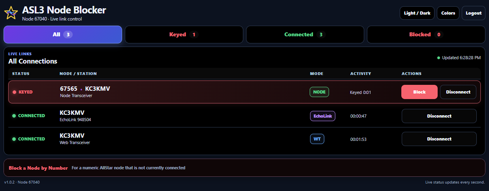
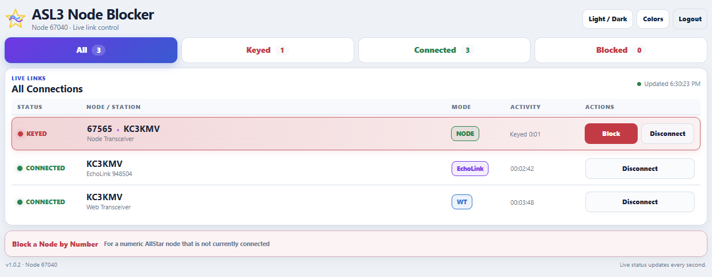

# ASL3 Node Blocker & Restore

ASL3 Node Blocker & Restore is a browser-based utility for AllStarLink 3 nodes.

It provides a quick way to see current connections, identify keyed stations, disconnect a connection, block a problem AllStar node from reconnecting, and restore access later.

## Features

- Live Links display for active connections
- Keyed connections automatically shown first
- AllStar node number and callsign display
- Disconnect connected AllStar nodes without blocking them
- Disconnect & Block numeric AllStar nodes
- Web Transceiver detection with Disconnect-only control
- EchoLink callsign and official EchoLink node identification
- EchoLink Disconnect-only control
- Blocked-node display read from the ASL3/Asterisk denylist
- Restore blocked nodes
- Manual block by AllStar node number
- All, Keyed, Connected, and Blocked filters
- Optional administrator password
- Light and dark themes with Default or Advanced custom colors
- Desktop and cellphone friendly
- Automatic local ASL3 node detection
- Update notification star that pulses when a newer GitHub version is available

**Default** is the normal appearance mode. **Advanced** lets you choose your own colors separately for Light and Dark.


## Screenshots

<p align="center">
  <a href="screenshot-dark.png"></a>
</p>

<p align="center">
  <a href="screenshot-light.png"></a>
</p>

## Requirements

Tested and working on:

- AllStarLink 3
- Debian 13 (Trixie)
- Apache 2
- PHP 8.x

## First-Time Installation

```bash
cd /var/www/html
sudo git clone https://github.com/TerryClaiborne/asl3_node_blocker_restore.git asl3_blocker
cd asl3_blocker
sudo ./setup_asl3_node_blocker_restore.sh
```

When setup completes, it will display the browser address.

Example:

```text
http://<NODE-IP>/blocker/
```

Open that address in a browser.

## Administrator Login

Login is optional and is disabled by default.

To set an administrator password and enable login:

```bash
sudo /var/www/html/asl3_blocker/setup_asl3_node_blocker_restore.sh --set-admin-password
```

Open the Blocker page, click **Login**, and enter the administrator password. The login page asks for the password only.

The administrator user is:

```text
admin
```

Re-enable login using the saved password hash:

```bash
sudo /var/www/html/asl3_blocker/setup_asl3_node_blocker_restore.sh --enable-auth
```

Disable login while preserving the saved password hash:

```bash
sudo /var/www/html/asl3_blocker/setup_asl3_node_blocker_restore.sh --disable-auth
```

## config.ini

The installer creates the local configuration file:

```text
/var/www/html/asl3_blocker/config.ini
```

The login setting is controlled by:

```text
ASL3_BLOCKER_AUTH_ENABLED=0
```

`0` means login is disabled.

```text
ASL3_BLOCKER_AUTH_ENABLED=1
```

`1` means login is enabled.

The file also stores the detected local node number, administrator user, and saved password hash.

`config.ini` is local/private configuration and **must not be uploaded or committed to GitHub**. It is already excluded by the repository `.gitignore`.

## Updating an Existing Installation

```bash
cd /var/www/html/asl3_blocker
sudo git pull origin main
sudo ./setup_asl3_node_blocker_restore.sh
```

Existing local settings and the administrator password are preserved during updates.

## Uninstall

```bash
sudo /var/www/html/asl3_blocker/setup_asl3_node_blocker_restore.sh --uninstall
```
